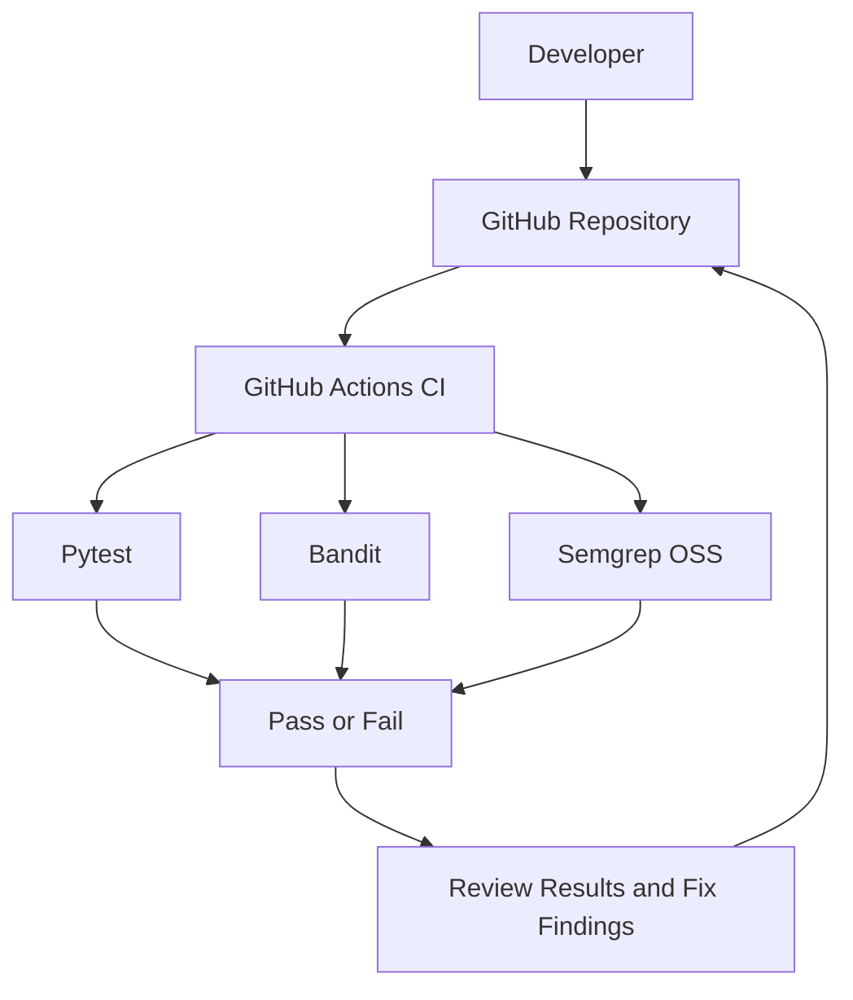

# Secure Code Review Tool — Architecture

## Workflow

1. A developer pushes code or opens a pull request.
2. GitHub Actions starts the configured CI workflow.
3. Pytest checks application behavior.
4. Bandit performs Python security analysis.
5. Semgrep runs custom and OSS security rules.
6. The developer reviews failures or findings and fixes issues.
